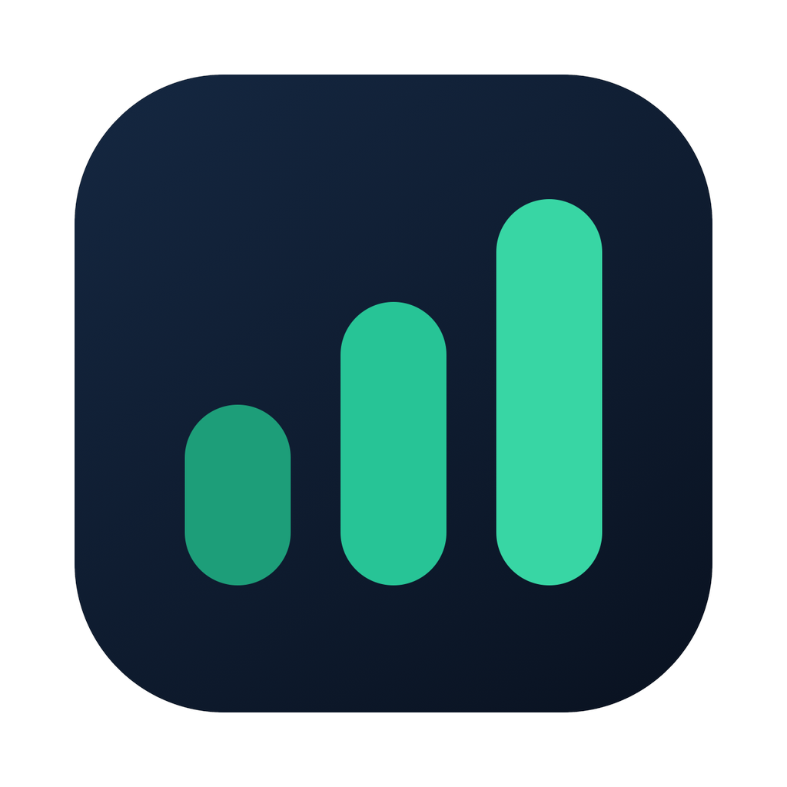
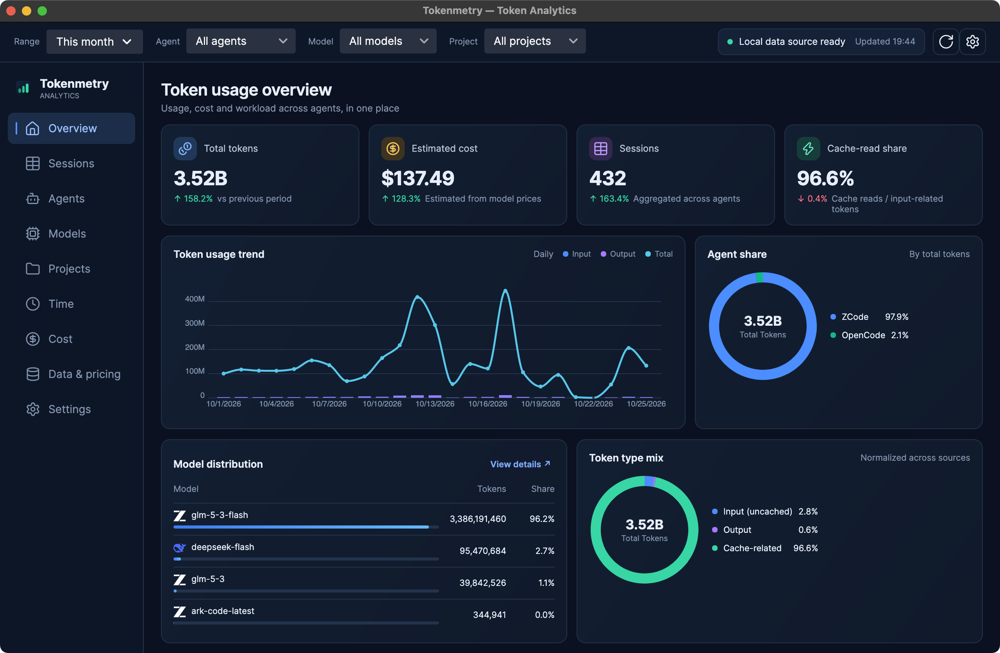

<div align="center">

  

# Tokenmetry

**See what your AI coding agents cost — the moment you open the app.**

Local-first · Tray-resident · Reconcilable — usage from every AI coding agent, distilled into a fixed set of views we picked for you.

[](https://github.com/cholf5/tokenmetry/actions/workflows/ci.yml)


[](LICENSE)

[简体中文](README.md) | **English**

</div>

<p align="center">
  
</p>

*Overview: KPIs, cost trend, and agent breakdown. The UI ships in Chinese and English, with light and dark themes. Screenshot shows the Chinese UI.*

## Why this exists

- **Your numbers are scattered.** Claude Code, Codex, ZCode… every agent logs usage in its own format, in its own place. Mix a few of them and you can't say what today actually cost.
- **Existing CLIs are slow.** `ccusage` rescans everything on every run; a cold start can take tens of seconds. Tokenmetry reads local logs directly and stores facts incrementally in SQLite — numbers are there the moment you open it.
- **No black boxes.** Every cost figure can be reconciled against `ccusage` CLI output (see [below](#reconcilable-the-trust-anchor)) — that is the product's trust anchor.

## Features

- **Read-only adapters for 19 agent data sources** — zero-config auto-detection of local logs/databases, no external processes spawned
- **9 fixed views** — Overview / Sessions / Agents / Models / Projects / Time / Cost / Data & Pricing / Settings; time analysis includes an hour heatmap and weekday distribution
- **Three-tier pricing fallback** — user overrides → models.dev remote refresh (background, 24h TTL, never blocks the UI) → built-in price snapshot
- **Honest cost accounting** — costUSD from logs is used as-is; models without pricing show "unknown", **never zero-filled or folded into totals**
- **Incremental ingestion** — tracked by file mtime/size, rescanned only on change; reruns never duplicate records, deleted files drop out of the facts
- **Tray-resident** — the popover shows today's tokens / spend / live rate at a glance, with cost anomalies flagged by a badge
- **Light & dark themes, Chinese & English UI** — follow the system or override
- **CSV export + global filters** — time range, agent, model, and project filters carry across every view

## Supported data sources

All are **read-only** (streaming JSONL/JSON parsing, or read-only SQLite connections), with environment-variable overrides for data directories:

| Agent | How it reads | Agent | How it reads |
|---|---|---|---|
| Claude Code | JSONL files | Kimi Code | JSONL files |
| Codex CLI | JSONL files | Amp | JSON thread files |
| ZCode | SQLite (read-only) | Droid (Factory) | session snapshot JSON |
| DSH | session logs (zstd JSONL) | Hermes | SQLite (read-only) |
| GitHub Copilot CLI | events.jsonl + otel | Kilo | SQLite (read-only) |
| OpenCode | SQLite (read-only) | Codebuff | chat-messages JSON |
| Gemini CLI | JSON / JSONL | pi-agent | session directories |
| Qwen Code | JSONL files | OpenClaw | SQLite + dual formats |
| Goose | SQLite (read-only) | Antigravity | SQLite, multi-root dedup |
| Grok | updates.jsonl | | |

## Getting started

**Run from source** (the primary method for now) — you need the [.NET 10 SDK](https://dotnet.microsoft.com/download/dotnet/10.0) and to have used at least one agent from the table above (so local logs exist):

```bash
git clone https://github.com/cholf5/tokenmetry.git
cd tokenmetry
dotnet run --project src/Tokenmetry.App
```

**Installers** — the release pipeline is ready: pushing a version tag makes CI produce macOS (arm64/x64 .app zips) plus Windows/Linux single-file zips, published to [Releases](https://github.com/cholf5/tokenmetry/releases). The app also checks for updates in-app (tray menu "Check for updates" or the About section in Settings, one-click download). Until the first public release ships, please build from source.

With no data, the app shows an empty-state guide (supported agents + rescan) instead of a stack trace. Release pipeline details: [`docs/release/ci-release.md`](docs/release/ci-release.md).

## Design stance

1. **Local-first** — no uploads, no sign-in, no cloud sync; fully functional offline.
2. **Reconcilable** — cost figures match `ccusage` CLI within tolerance.
3. **Offline-first pricing** — online refresh is a background enhancement and never blocks the UI.
4. **Fixed information architecture** — the views are chosen for you; no plugins, no layout customization.
5. **Restrained data presentation** — trend, composition, anomaly. Three expressions are enough.

## Reconcilable (the trust anchor)

The homegrown pipeline (direct JSONL parsing → unified usage records → own pricing engine → UTC calendar-day aggregation) is reconciled day-by-day, model-by-model, against `npx ccusage@20.0.29`:

- **All five token components (input / output / cache_creation / cache_read / total) match exactly**;
- On real data, costs matched **to the cent** (local Codex: 19 files / 2,931 records, $101.3856438 over the full period);
- Reconciliation tests parse golden JSON committed to the repo — repeatable offline. The full alignment rules (costUSD priority, `-fast` price stripping, message dedup, cumulative guards, …) live in [`docs/reconciliation/2026-10-11-reconciliation.md`](docs/reconciliation/2026-10-11-reconciliation.md).

## Privacy

The SQLite store holds **aggregated facts and settings only** — never prompts, code, or conversation content. All data stays on your machine (`%LOCALAPPDATA%\Tokenmetry\` on Windows, the user data directory on macOS/Linux).

## Architecture

```
Tokenmetry.Core             models · adapter interfaces · query/pricing/anomaly services · built-in price snapshot
        ▲
Tokenmetry.Infrastructure   19 source adapters · SQLite facts store (sequential schema_migrations)
                            · ModelsDev pricing client · ccusage CLI reconciliation
        ▲
Tokenmetry.App              Avalonia UI (Semi theme) · 9 views · DI · tray · i18n
```

Three layers, strictly one-way dependencies. Adding an agent source = Core interface + Infrastructure adapter + DI registration + fixture tests. Details in [`AGENTS.md`](AGENTS.md).

## Roadmap

| Milestone | Scope | Status |
|---|---|---|
| v0.1–v0.2 | Real-data dashboard, reports, CSV export, settings | ✅ |
| v0.3 | Own ingestion engine (Claude/Codex direct reads, facts tables, pricing engine, reconciliation tests) | ✅ |
| v0.3.5 | Multi-source coverage (17 more adapters landed) | ✅ |
| v0.4 | UI prototype realized (Semi theme + 3-pane shell + 9 views + charts) | ✅ |
| v0.5 | Resident experience (notification dedup, budget thresholds, autostart, refresh reliability) | planned |
| v0.9 | Release automation (tag-triggered 3-platform CI packaging + Releases + in-app update check/download) | ✅ |
| v1.0 | Stable release (Windows installer, macOS notarization) | planned |

Full direction in [`docs/kanban/roadmap.md`](docs/kanban/roadmap.md); task cards on the kanban board in [`docs/kanban/board.md`](docs/kanban/board.md).

## Development

```bash
dotnet build Tokenmetry.sln     # build
dotnet test  Tokenmetry.sln     # all tests
```

- .NET 10 / C# / Avalonia 12; 1,500+ tests (xUnit + FluentAssertions). UI tests run on Avalonia Headless, no display needed.
- Before touching parsing, pricing, or aggregation semantics, read the [reconciliation doc](docs/reconciliation/2026-10-11-reconciliation.md) — the item-by-item alignment table with ccusage lives there.
- Engineering conventions for AI agents (architecture boundaries, i18n/design-token discipline, naming-history traps) are in [`AGENTS.md`](AGENTS.md).

## License

Released under **AGPL-3.0-or-later** (full text in [`LICENSE`](LICENSE)):

- You are free to use, study, modify, and redistribute this project, including internal company use;
- Modified versions offered in any form — distributed packages or network services — must make the complete source available under the same license;
- If you need a closed-source integration that AGPL doesn't permit, contact the author (GitHub Issues) to discuss a commercial license.

The "Tokenmetry" name and app icon are project brand marks, outside the scope of this license; please rebrand derivative distributions or clearly mark them as unofficial.
