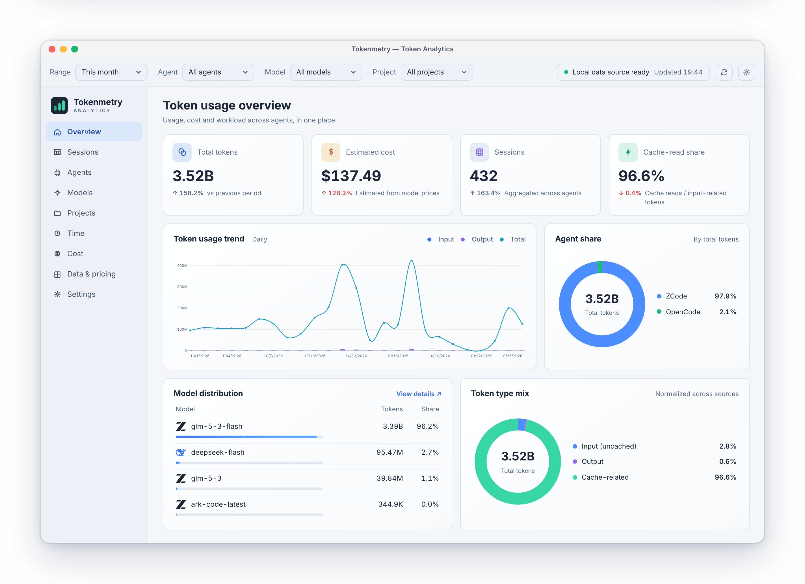
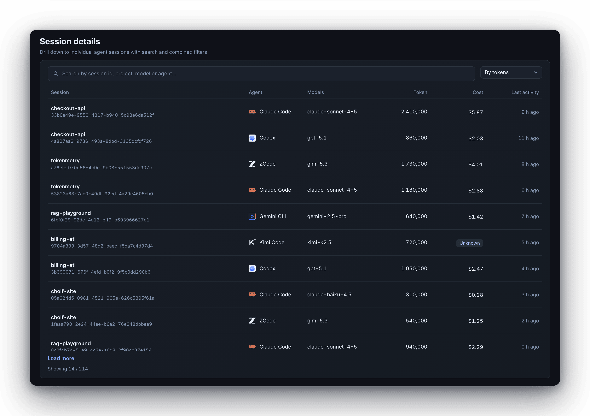
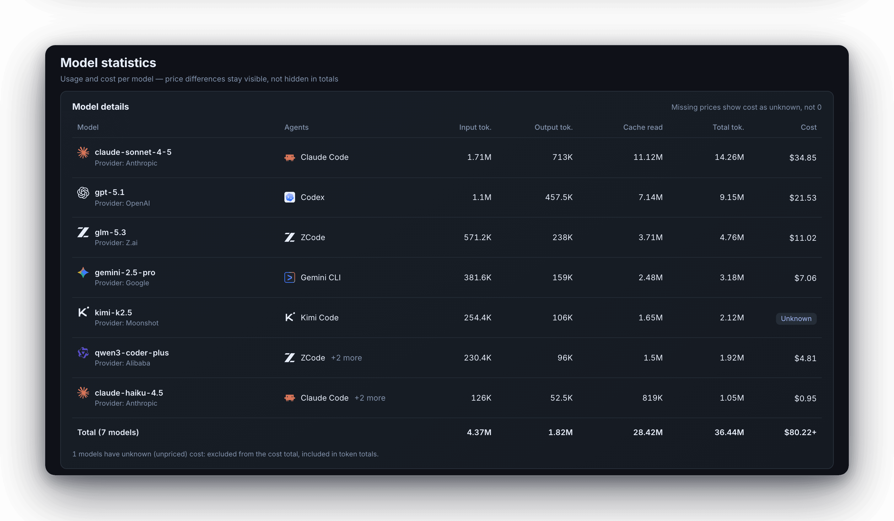
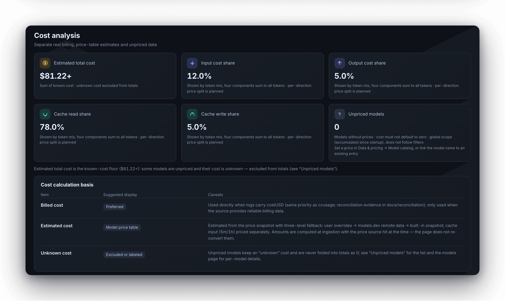
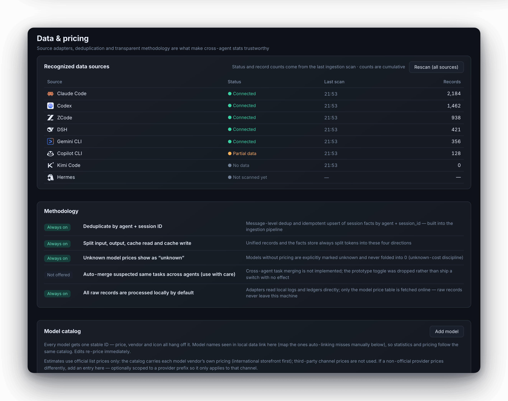
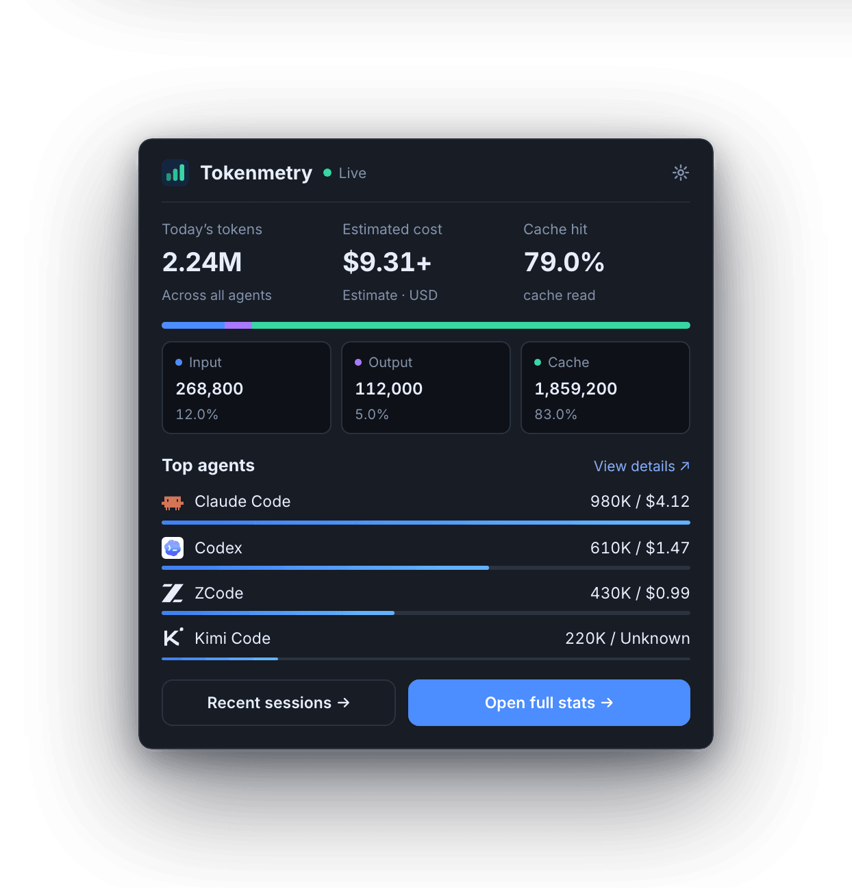

<div align="center">

  

# Tokenmetry

**Open it and know what your AI coding costs.**

Tokenmetry is a desktop app for Windows, macOS and Linux that reads the local logs your coding
agents already write — Claude Code, Codex, ZCode and 17 more — indexes them incrementally into a
local SQLite store, and lays usage and cost out in a fixed set of views. Nothing is uploaded, and
every cost figure can be checked against ccusage.

[](https://github.com/cholf5/tokenmetry/actions/workflows/ci.yml)
[](https://github.com/cholf5/tokenmetry/releases/latest)

[](https://tokenmetry.app)
[](LICENSE)

**English** | [简体中文](README.zh-CN.md)

</div>

<p align="center">
  <picture>
    <source media="(prefers-color-scheme: dark)" srcset="docs/screenshots/overview-en-dark.png">
    
  </picture>
</p>

## Why another usage tool

Every agent keeps its own log: JSONL here, session snapshots there, a SQLite database elsewhere.
Use two or three of them and you honestly cannot say what today cost. Tokenmetry reads them all —
read-only, auto-detected, zero config.

`ccusage` re-parses every log on every run, and a cold start can take tens of seconds
([measurements](docs/chore/why-ccusage-so-slow.md)). Tokenmetry tracks files by mtime and size,
re-reads only what changed, and lands results incrementally in SQLite — the numbers are ready when
the window opens.

And an estimate you cannot verify is just a guess. So cost is treated as a correctness target: day
by day, model by model, Tokenmetry's numbers reconcile against the ccusage CLI
([see below](#check-the-numbers)). Models without prices show **unknown** — they are never zeroed
into totals.

## A look inside

Nine fixed views: Overview, Sessions, Agents, Models, Projects, Time, Cost, Data & pricing,
Settings. No plugins, no layout customization — the views are chosen for you, and time-range,
agent, model and project filters run through all of them.

<div align="center">
  <table>
    <tr>
      <td></td>
      <td></td>
    </tr>
    <tr>
      <td></td>
      <td></td>
    </tr>
  </table>
</div>

It also lives in the tray — today's tokens, estimated cost and cache-hit rate at a glance, live
rate tracking, and a badge when spend looks abnormal:

<p align="center">
  
</p>

## What it does

<table>
  <tr><td width="230"><strong>20 data sources, read-only</strong></td><td>Auto-detected local logs and databases — streaming JSONL/JSON parsers or read-only SQLite connections. No external processes are spawned.</td></tr>
  <tr><td><strong>Incremental ingestion</strong></td><td>Files are tracked by mtime and size; only changes get re-read. Re-runs never duplicate records, and deleted files drop out of the store.</td></tr>
  <tr><td><strong>Costs you can audit</strong></td><td>costUSD carried by the logs is used as-is; unpriced models show "unknown" and stay out of cost totals.</td></tr>
  <tr><td><strong>Three-tier pricing</strong></td><td>Your overrides → a models.dev refresh in the background (24 h TTL, never blocks the UI) → a price snapshot bundled with the app.</td></tr>
  <tr><td><strong>Tray-resident</strong></td><td>Today's tokens, spend and live rate in the popover; abnormal spend raises a badge.</td></tr>
  <tr><td><strong>CSV export + global filters</strong></td><td>Time range, agent, model and project filters carry across every view.</td></tr>
  <tr><td><strong>Light & dark, 10 languages</strong></td><td>English, Simplified/Traditional Chinese, Japanese, Korean, Portuguese (BR), Russian, Spanish, German, French — switchable at runtime, follow-system by default.</td></tr>
  <tr><td><strong>An honest empty state</strong></td><td>With no data, the app shows the supported-agent list and a rescan button, not a stack trace.</td></tr>
</table>

## Data sources

All 20 are read-only (streamed JSONL/JSON parsing, or read-only SQLite connections), with
environment-variable overrides for data directories:

| Agent | How it reads | Agent | How it reads |
|---|---|---|---|
| Claude Code | JSONL files | Kimi Code | JSONL files |
| Codex CLI | JSONL files | Amp | JSON thread files |
| ZCode | SQLite (read-only) | Droid (Factory) | session snapshot JSON |
| DSH | session logs (zstd JSONL) | Hermes | SQLite (read-only) |
| GitHub Copilot CLI | events.jsonl + otel | Kilo | SQLite (read-only) |
| OpenCode | SQLite (read-only) | Codebuff | chat-messages JSON |
| Gemini CLI | JSON / JSONL | pi-agent | session directories |
| Qwen Code | JSONL files | OpenClaw | SQLite + dual formats |
| Goose | SQLite (read-only) | Antigravity | SQLite, multi-root dedup |
| Grok | updates.jsonl | Cindy | pi session dirs |

Cindy covers the Pi runtime only: sessions it starts for Claude Code / Codex still count toward
those agents; zero-cost entries backfilled by its gateway count as unknown, never zero; and one
session file is billed once, never twice.

## Install

Grab a package from [Releases](https://github.com/cholf5/tokenmetry/releases/latest). CI builds
all three platforms on every tag:

| Platform | Package | Size (v0.3.2) | Notes |
|---|---|---|---|
| Windows x64 | `Tokenmetry-0.3.2-win-x64-setup.exe` | 17.3 MB | Recommended — per-user install with shortcuts and an uninstaller; in-app updates are silent |
| Windows x64 | `Tokenmetry-0.3.2-win-x64.zip` | 70.8 MB | Portable, single exe |
| macOS Apple Silicon | `Tokenmetry-0.3.2-osx-arm64.zip` | 23.1 MB | `.app`, Native AOT |
| macOS Intel | `Tokenmetry-0.3.2-osx-x64.zip` | 24.6 MB | `.app`, Native AOT |
| Linux x64 | `Tokenmetry-0.3.2-linux-x64.zip` | 66.4 MB | Single-file binary |

Installed Windows copies upgrade themselves ("Check for updates" downloads, installs and
restarts); portable copies and macOS/Linux update by extracting over the old version.

**macOS needs one Gatekeeper allowance on first launch** (the app is unsigned, and on macOS 26 the
old right-click → Open trick no longer works). Either allow it in System Settings → Privacy &
Security → "Open Anyway", or run:

```bash
xattr -cr /Applications/Tokenmetry.app
```

Windows is blocked once by SmartScreen (→ "More info" → "Run anyway"). Full steps for both:
[known limitations](docs/release/known-limitations.md), item 9.

**Run from source** — you need the [.NET 10 SDK](https://dotnet.microsoft.com/download/dotnet/10.0)
and local logs from at least one agent in the table above:

```bash
git clone https://github.com/cholf5/tokenmetry.git
cd tokenmetry
dotnet run --project src/Tokenmetry.App
```

## Check the numbers

The homegrown pipeline (direct JSONL/SQLite reads → unified usage records → own pricing engine →
UTC calendar-day buckets) is reconciled day-by-day and model-by-model against `npx ccusage@20.0.29`:

- All five token components match exactly — input, output, cache write, cache read, total.
- On real local data (Codex: 19 files / 2,931 records), costs matched to the cent: $101.3856438
  over the full period.
- Reconciliation tests parse only the golden JSON committed to the repo, so they repeat offline.
  The full alignment rules (costUSD priority, `-fast` price stripping, message dedup, cumulative
  guards, …) are in
  [`docs/reconciliation/2026-10-11-reconciliation.md`](docs/reconciliation/2026-10-11-reconciliation.md).

## Privacy

The SQLite store holds aggregated facts and settings only — never prompts, code or conversation
content. Everything stays on your machine (`%LOCALAPPDATA%\Tokenmetry\` on Windows, the user data
directory on macOS/Linux). The only two network touchpoints are the models.dev price refresh and
the in-app update check.

## Known limitations

Stated plainly rather than hidden
([full list](docs/release/known-limitations.md)):

- Packages are unsigned — SmartScreen (Windows) and Gatekeeper (macOS) each block once.
- A failed read in one source is swallowed silently: the UI still looks normal, but that source may
  undercount. This is the top priority after release.
- Changing the system timezone (or crossing a DST boundary) can double-count some days.
- One corrupt timestamp can knock out the Kimi or DSH source until the offending file is moved.
- Only installed Windows copies update silently; portable and macOS/Linux copies update by hand.

## How it's built

```
Tokenmetry.Core             models · adapter interfaces · query/pricing/anomaly services · built-in price snapshot
        ▲
Tokenmetry.Infrastructure   20 source adapters · SQLite facts store (sequential schema_migrations)
                            · ModelsDev pricing client · ccusage CLI reconciliation
        ▲
Tokenmetry.App              Avalonia UI (Semi theme) · 9 views · DI · tray · i18n
```

Three layers, strictly one-way dependencies. Adding a source = a Core interface + an
Infrastructure adapter + DI registration + fixture tests. Engineering conventions for AI agents
(architecture boundaries, i18n/design-token discipline, naming-history traps) live in
[`AGENTS.md`](AGENTS.md).

```bash
dotnet build Tokenmetry.sln     # build
dotnet test  Tokenmetry.sln     # all tests
```

.NET 10 / C# / Avalonia 12; 1,600+ tests (xUnit + FluentAssertions), the UI layer running on
Avalonia Headless so no display is needed. Before changing parsing, pricing or aggregation
semantics, read the
[reconciliation doc](docs/reconciliation/2026-10-11-reconciliation.md) first — the item-by-item
alignment table with ccusage lives there.

## Roadmap

| Milestone | Scope | Status |
|---|---|---|
| v0.1–v0.2 | Real-data dashboard, reports, CSV export, settings | ✅ |
| v0.3 | Own ingestion engine (Claude/Codex direct reads, facts store, pricing engine, reconciliation tests) | ✅ |
| v0.3.5 | Multi-source coverage (all 20 adapters landed) | ✅ |
| v0.4 | UI realization (Semi theme + three-pane shell + 9 views + charts) | ✅ |
| v0.3.1–v0.3.2 | Windows installer + silent in-app updates; Native AOT installers | ✅ |
| v0.9 | Release automation (tag-triggered 3-platform CI packaging + Releases + in-app update check) | ✅ |
| v0.5 | Resident experience (notification dedup, budget thresholds, autostart, refresh reliability) | planned |
| v1.0 | Stable release (Windows installer ✅, macOS notarization ⬜) | in progress |

Full direction in [`docs/kanban/roadmap.md`](docs/kanban/roadmap.md); task cards on the kanban
board in [`docs/kanban/board.md`](docs/kanban/board.md).

## License

Released under **AGPL-3.0-or-later** ([full text](LICENSE)). You are free to use, study, modify
and redistribute this project, including inside a company. If you offer a modified version in any
form — a package, or a network service — the complete source must come out under the same
license. If you need a closed-source integration that AGPL doesn't permit, contact the author via
GitHub Issues to discuss a commercial license.

The "Tokenmetry" name and app icon are brand marks, outside the scope of this license; rebrand
derivative distributions or mark them clearly as unofficial.
