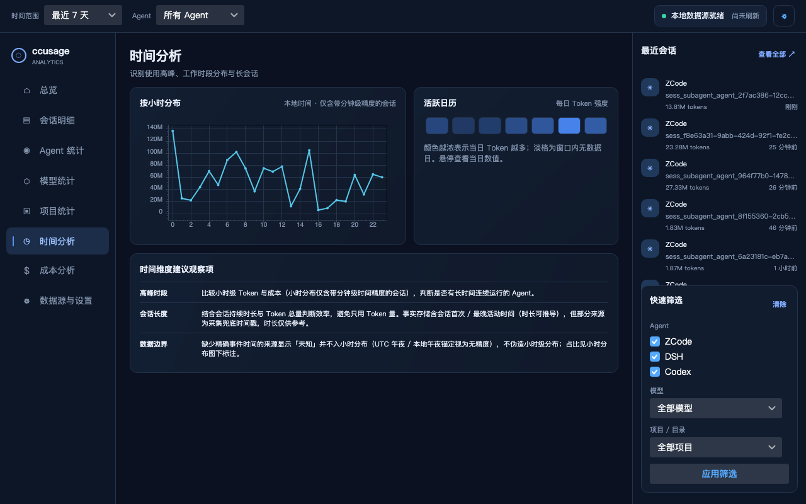

<div align="center">

# Tokenmetry

**打开就知道 AI 编程花了多少钱、是否异常、钱花在哪。**

*本地优先 · 托盘常驻 · 可对账 —— 把你所有 AI 编程 Agent 的用量，聚合成一套替你选好的固定视图。*


</div>

---

<p align="center">
  
</p>

> 上图为设计基准原型（`docs/design/ccusage_analytics_prototype.html`）。实现以 Semi.Avalonia 主题 + ScottPlot / 自绘控件对齐此观感，共 8 个固定视图 × 明暗两套主题。

## 为什么做这个

- **数字散落各处**：Claude Code、Codex、ZCode……每个 Agent 的用量日志格式不同、位置不同，混用时你根本说不清今天烧了多少钱。
- **现成 CLI 太慢**：`ccusage` 每次全量重扫日志，冷启动动辄几十秒（分析见 [`docs/chore/why-ccusage-so-slow.md`](docs/chore/why-ccusage-so-slow.md)）。Tokenmetry 直读本地日志，增量扫描落进 SQLite facts 表，打开即出数。
- **不信任黑盒**：任何成本数字都能与 `ccusage` CLI 输出对账核对（见下文[「可对账」](#可对账信任锚)）——这是产品的信任锚。

## 特性

- 🔌 **19 个 Agent 数据源直读** —— 只读本地日志/数据库，零配置自动探测，不 spawn 外部进程
- 📊 **9 个固定视图** —— 总览 / 会话明细 / Agent 统计 / 模型统计 / 项目统计 / 时间分析 / 成本分析 / 数据与计价 / 设置
- 💰 **三级定价回退** —— 用户覆盖 → models.dev 远程刷新（后台、TTL 24h、永不阻塞 UI）→ 内置价格快照
- ❓ **诚实的成本口径** —— 日志自带 costUSD 直接采用；缺价模型显示「未知」**不折零、不混入合计**，绝不假装精确
- 🔁 **增量采集** —— 文件 mtime/大小记账，变更才重扫；重复运行不产生重复记录，文件删除后记录随之移除
- 🖥️ **托盘常驻** —— 后台自动刷新、异常成本检测通知，5 秒知道状态
- 🌓 **明暗主题 + 中英双语** —— light / dark / system 跟随，界面语言 zh / en / system 即时切换
- 📤 **CSV 导出、全局筛选** —— 时间范围（今日 / 7 / 30 / 90 天 / 自定义）与 Agent 筛选贯穿所有视图

## 支持的数据源

全部为**只读直读**（JSONL/JSON 文件流式解析，或 SQLite 只读连接），支持环境变量覆盖数据目录：

| Agent | 读取方式 | | Agent | 读取方式 |
|---|---|---|---|---|
| Claude Code | JSONL 直读 | | Kimi Code | JSONL 直读 |
| Codex CLI | JSONL 直读 | | Amp | JSON 线程文件 |
| ZCode | SQLite 只读 | | Droid (Factory) | 会话快照 JSON |
| DSH | 会话日志（zstd JSONL） | | Hermes | SQLite 只读 |
| GitHub Copilot CLI | 会话 events.jsonl + otel | | Kilo | SQLite 只读 |
| OpenCode | SQLite 只读 | | Codebuff | chat-messages JSON |
| Gemini CLI | JSON / JSONL | | pi-agent | 会话目录 |
| Qwen Code | JSONL 直读 | | OpenClaw | SQLite + 双格式 |
| Goose | SQLite 只读 | | Antigravity | SQLite 多根去重 |
| Grok | updates.jsonl | | | |

## 快速开始

前提：本机装有 [.NET 10 SDK](https://dotnet.microsoft.com/download/dotnet/10.0)；已使用过任一上表中的 Agent（有本地日志）。

```bash
git clone https://github.com/cholf5/ccusage-desktop.git
cd ccusage-desktop
dotnet run --project src/Tokenmetry.App
```

无数据时应用会显示空态引导（支持的 Agent 清单 + 重新扫描），永不暴露堆栈。目前以 Windows 为主要发布目标，macOS/Linux 下可开发与运行测试；安装包与打包自动化在 v1.0 规划中。

## 设计立场

1. **本地优先** —— 不上传、不登录、不云同步；断网功能完整。
2. **可对账** —— 成本数字与 `ccusage` CLI 容差内一致。
3. **离线优先定价** —— 联网刷新只是后台增强，永远不阻塞 UI。
4. **固定信息架构** —— 视图是我们替你选好的，不做插件、不做布局自定义。
5. **克制的数据表达** —— 趋势、构成、异常，三种表达够用。

## 可对账（信任锚）

自研链路（JSONL 直读 → 统一 usage 记录 → 自有定价引擎 → UTC 自然日聚合）与 `npx ccusage@20.0.29` 逐日 × 逐模型对账：

- **tokens 五分量（input / output / cache_creation / cache_read / total）精确一致**；
- 真实数据实测 cost 两侧**逐分钱一致**（本机 Codex：19 文件 / 2931 条记录，全期 $101.3856438）；
- 对账测试只解析提交进仓库的 golden JSON，离线可重复；口径逐项对齐规则（costUSD 优先、`-fast` 剥价、消息去重、cumulative 守卫等）见 [`docs/reconciliation/2026-10-11-reconciliation.md`](docs/reconciliation/2026-10-11-reconciliation.md)。

## 隐私

SQLite 只存**聚合事实与配置**，不存 prompt、代码、会话内容；所有数据留在本机 `%LOCALAPPDATA%\Tokenmetry\`（macOS/Linux 为用户数据目录）。

## 架构

```
Tokenmetry.Core           模型 · 适配器接口 · 查询/定价/异常检测 · 内置价格快照
        ▲
Tokenmetry.Infrastructure  19 源适配器 · SQLite facts 存储（schema_migrations 顺序迁移）
                           · ModelsDev 定价客户端 · ccusage CLI 对账集成
        ▲
Tokenmetry.App             Avalonia UI（Semi 主题）· 8 视图 · DI · 托盘 · i18n
```

三层严格单向依赖；新增 Agent 源 = Core 接口 + Infrastructure 适配器 + DI 注册 + fixture 测试。详见 [`AGENTS.md`](AGENTS.md)。

## 路线图

| 里程碑 | 内容 | 状态 |
|---|---|---|
| v0.1–v0.2 | 真实数据 Dashboard、Reports、CSV 导出、Settings | ✅ |
| v0.3 | 自主采集引擎（Claude/Codex 直读、facts 表、定价引擎、对账测试） | ✅ |
| v0.3.5 | 多源覆盖（17 源适配器全部落地） | ✅ |
| v0.4 | UI 原型落地（Semi 主题 + 三栏外壳 + 8 视图 + 图表） | ✅ |
| v0.5 | 常驻体验（通知去重、预算阈值、自启、刷新可靠性） | 规划 |
| v1.0 | 稳定发布（安装包、CI release、图标品牌） | 规划 |

完整方向见 [`docs/kanban/roadmap.md`](docs/kanban/roadmap.md)，任务卡片看板见 [`docs/kanban/board.md`](docs/kanban/board.md)。

## 开发

```bash
dotnet build Tokenmetry.sln     # 构建
dotnet test  Tokenmetry.sln     # 全部测试
```

- .NET SDK 10，C# / Avalonia 12，测试用 xUnit + FluentAssertions；UI 层测试跑在 Avalonia Headless 上，可无头运行。
- 改动解析、计价或聚合口径前，先读[对账文档](docs/reconciliation/2026-10-11-reconciliation.md)——口径与 ccusage 的逐项对齐表在那里。
- 面向 AI Agent 的工程约定（架构边界、i18n/设计令牌纪律、命名史陷阱）见 [`AGENTS.md`](AGENTS.md)。
