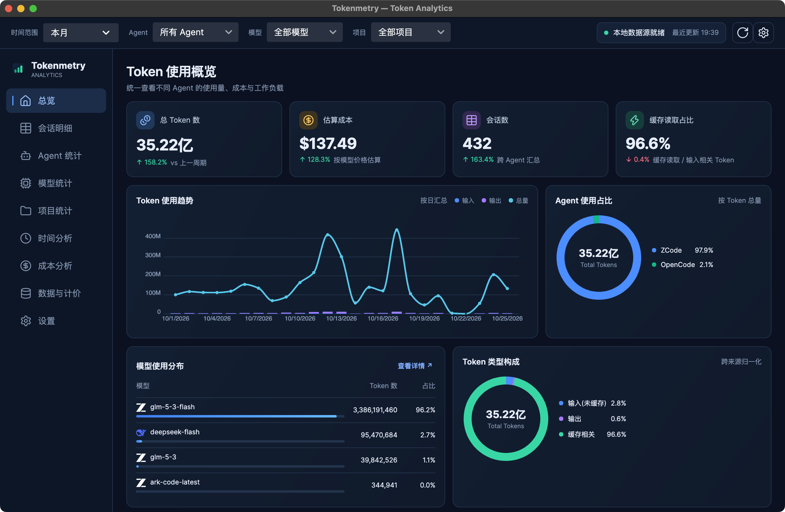

<div align="center">

  

# Tokenmetry

**打开就知道 AI 编程花了多少钱、是否异常、钱花在哪。**

本地优先 · 托盘常驻 · 可对账 —— 把所有 AI 编程 Agent 的用量,聚成一套替你选好的固定视图。

[](https://github.com/cholf5/tokenmetry/actions/workflows/ci.yml)


[](LICENSE)

**简体中文** | [English](README.en.md)

</div>

<p align="center">
  
</p>

## 为什么做这个

- **数字散落各处。** Claude Code、Codex、ZCode……每个 Agent 的日志格式不同、位置不同,混用时你根本说不清今天烧了多少钱。
- **现成 CLI 太慢。** `ccusage` 每次全量重扫日志,冷启动动辄几十秒(分析见 [`docs/chore/why-ccusage-so-slow.md`](docs/chore/why-ccusage-so-slow.md))。Tokenmetry 直读本地日志、增量落进 SQLite,打开即出数。
- **不信任黑盒。** 任何成本数字都能与 `ccusage` CLI 输出对账(见[下文](#可对账信任锚))——这是产品的信任锚。

## 特性

- **19 个 Agent 数据源只读直读** —— 零配置自动探测本地日志/数据库,不 spawn 外部进程
- **9 个固定视图** —— 总览 / 会话 / Agent / 模型 / 项目 / 时间分析 / 成本分析 / 数据与计价 / 设置;时间分析含小时热力图与星期分布
- **三级定价回退** —— 用户覆盖 → models.dev 远程刷新(后台、TTL 24h、永不阻塞 UI)→ 内置价格快照
- **诚实的成本口径** —— 日志自带 costUSD 直接采用;缺价模型显示「未知」,**不折零、不混入合计**,绝不假装精确
- **增量采集** —— 按文件 mtime/大小记账,变更才重扫;重复运行不产生重复记录,文件删除后记录随之移除
- **托盘常驻** —— 弹层一眼看今日 tokens / 花费 / 实时速率,成本异常以徽章标出
- **明暗主题 + 10 语种** —— light / dark / system 跟随,简体中文 / 繁体中文 / 英 / 日 / 韩 / 葡(BR) / 俄 / 西 / 德 / 法 + 跟随系统即时切换
- **CSV 导出 + 全局筛选** —— 时间范围、Agent、模型、项目四维筛选贯穿所有视图

## 支持的数据源

全部为**只读直读**(JSONL/JSON 文件流式解析,或 SQLite 只读连接),支持环境变量覆盖数据目录:

| Agent | 读取方式 | Agent | 读取方式 |
|---|---|---|---|
| Claude Code | JSONL 直读 | Kimi Code | JSONL 直读 |
| Codex CLI | JSONL 直读 | Amp | JSON 线程文件 |
| ZCode | SQLite 只读 | Droid (Factory) | 会话快照 JSON |
| DSH | 会话日志(zstd JSONL) | Hermes | SQLite 只读 |
| GitHub Copilot CLI | 会话 events.jsonl + otel | Kilo | SQLite 只读 |
| OpenCode | SQLite 只读 | Codebuff | chat-messages JSON |
| Gemini CLI | JSON / JSONL | pi-agent | 会话目录 |
| Qwen Code | JSONL 直读 | OpenClaw | SQLite + 双格式 |
| Goose | SQLite 只读 | Antigravity | SQLite 多根去重 |
| Grok | updates.jsonl | | |

## 快速开始

**从源码运行** —— 前提:本机装有 [.NET 10 SDK](https://dotnet.microsoft.com/download/dotnet/10.0),且用过上表任一 Agent(有本地日志):

```bash
git clone https://github.com/cholf5/tokenmetry.git
cd tokenmetry
dotnet run --project src/Tokenmetry.App
```

**安装包** —— Windows 取 `Tokenmetry-{版本}-win-x64-setup.exe`(安装向导,按用户安装到 `%LOCALAPPDATA%\Programs\Tokenmetry`,带开始菜单/桌面快捷方式与卸载器);其余平台取对应 zip(macOS arm64/x64 `.app`、Linux 单文件)解压即用。应用内「检查更新」在 Windows 安装版上会下载安装包并静默升级、自动重启;便携版与 macOS/Linux 则下载后在文件管理器里定位,解压替换即完成。所有包均未签名:Windows SmartScreen 与 macOS Gatekeeper 首次会各拦一次——两条都在[已知限制](docs/release/known-limitations.md)里写明。

无数据时应用显示空态引导(支持的 Agent 清单 + 重新扫描),不暴露堆栈。发布流程细节见 [`docs/release/ci-release.md`](docs/release/ci-release.md)。

## 设计立场

1. **本地优先** —— 不上传、不登录、不云同步;断网功能完整。
2. **可对账** —— 成本数字与 `ccusage` CLI 容差内一致。
3. **离线优先定价** —— 联网刷新只是后台增强,永远不阻塞 UI。
4. **固定信息架构** —— 视图是我们替你选好的,不做插件、不做布局自定义。
5. **克制的数据表达** —— 趋势、构成、异常,三种表达够用。

## 可对账(信任锚)

自研链路(JSONL 直读 → 统一 usage 记录 → 自有定价引擎 → UTC 自然日聚合)与 `npx ccusage@20.0.29` 逐日 × 逐模型对账:

- **tokens 五分量(input / output / cache_creation / cache_read / total)精确一致**;
- 真实数据实测 cost 两侧**逐分钱一致**(本机 Codex:19 文件 / 2931 条记录,全期 $101.3856438);
- 对账测试只解析提交进仓库的 golden JSON,离线可重复;口径逐项对齐规则(costUSD 优先、`-fast` 剥价、消息去重、cumulative 守卫等)见 [`docs/reconciliation/2026-10-11-reconciliation.md`](docs/reconciliation/2026-10-11-reconciliation.md)。

## 隐私

SQLite 只存**聚合事实与配置**,不存 prompt、代码、会话内容;所有数据留在本机(Windows 为 `%LOCALAPPDATA%\Tokenmetry\`,macOS/Linux 为用户数据目录)。

## 已知限制

首版带有若干已知问题——某源读失败会被静默吞掉(界面仍显示正常,可能少算)、改过系统时区后可能双算、
所有包都未签名(Windows SmartScreen / macOS Gatekeeper 首次会各拦一次)、macOS 与 Linux 的更新仍需手动解压替换、
Kimi/DSH 一条坏时间戳能让整源停摆。逐条写清症状、触发条件与后续计划:
[`docs/release/known-limitations.md`](docs/release/known-limitations.md)。其中双算那条是发版后的第一优先级。

## 架构

```
Tokenmetry.Core             模型 · 适配器接口 · 查询/定价/异常检测 · 内置价格快照
        ▲
Tokenmetry.Infrastructure   19 源适配器 · SQLite facts 存储(schema_migrations 顺序迁移)
                            · ModelsDev 定价客户端 · ccusage CLI 对账集成
        ▲
Tokenmetry.App              Avalonia UI(Semi 主题)· 9 视图 · DI · 托盘 · i18n
```

三层严格单向依赖;新增 Agent 源 = Core 接口 + Infrastructure 适配器 + DI 注册 + fixture 测试。详见 [`AGENTS.md`](AGENTS.md)。

## 路线图

| 里程碑 | 内容 | 状态 |
|---|---|---|
| v0.1–v0.2 | 真实数据 Dashboard、Reports、CSV 导出、Settings | ✅ |
| v0.3 | 自主采集引擎(Claude/Codex 直读、facts 表、定价引擎、对账测试) | ✅ |
| v0.3.5 | 多源覆盖(19 源适配器全部落地) | ✅ |
| v0.4 | UI 原型落地(Semi 主题 + 三栏外壳 + 9 视图 + 图表) | ✅ |
| v0.5 | 常驻体验(通知去重、预算阈值、自启、刷新可靠性) | 规划 |
| v0.9 | 发布自动化(tag 触发三平台 CI 打包 + Release + 应用内更新检查/下载) | ✅ |
| v1.0 | 稳定发布(Windows 安装器 ✅、macOS 公证 ⬜) | 进行中 |

完整方向见 [`docs/kanban/roadmap.md`](docs/kanban/roadmap.md),任务卡片看板见 [`docs/kanban/board.md`](docs/kanban/board.md)。

## 开发

```bash
dotnet build Tokenmetry.sln     # 构建
dotnet test  Tokenmetry.sln     # 全部测试
```

- .NET 10 / C# / Avalonia 12;1500+ 测试(xUnit + FluentAssertions),UI 层测试跑在 Avalonia Headless 上,可无头运行。
- 改动解析、计价或聚合口径前,先读[对账文档](docs/reconciliation/2026-10-11-reconciliation.md)——口径与 ccusage 的逐项对齐表在那里。
- 面向 AI Agent 的工程约定(架构边界、i18n/设计令牌纪律、命名史陷阱)见 [`AGENTS.md`](AGENTS.md)。

## License

本项目以 **AGPL-3.0-or-later** 发布(全文见 [`LICENSE`](LICENSE)):

- 你可以自由地使用、学习、修改和再分发本项目,包括在公司内部日常使用;
- 修改后的版本无论以何种形式提供——分发安装包,还是仅作为网络服务运行——都必须以相同许可证开放完整源代码;
- 需要在不满足 AGPL 义务的场景下闭源集成,欢迎联系作者(GitHub Issues)单独协商商业授权。

「Tokenmetry」名称与应用图标属于项目品牌标识,不在本许可证授权范围内;再分发衍生版本时请更换品牌,或明确标注为非官方版本。
