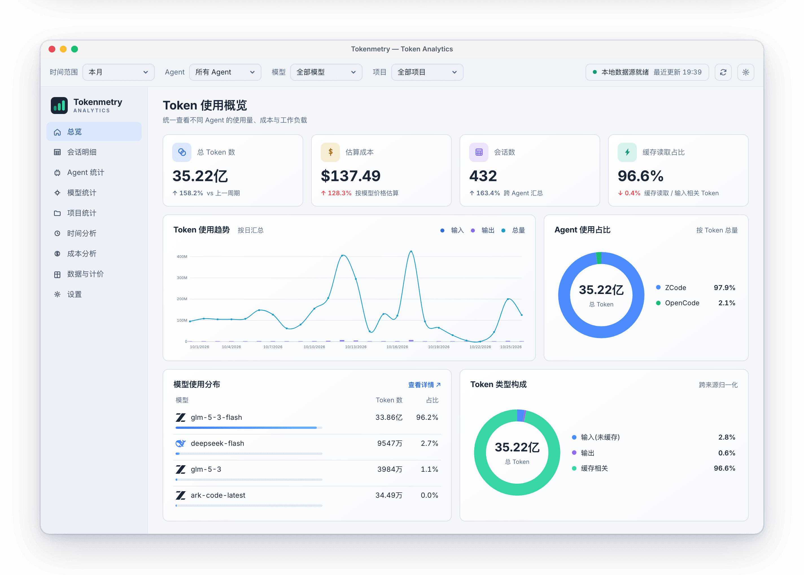
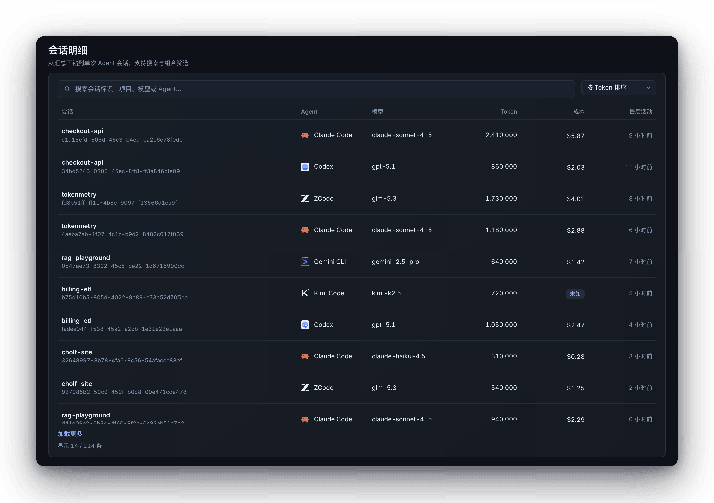
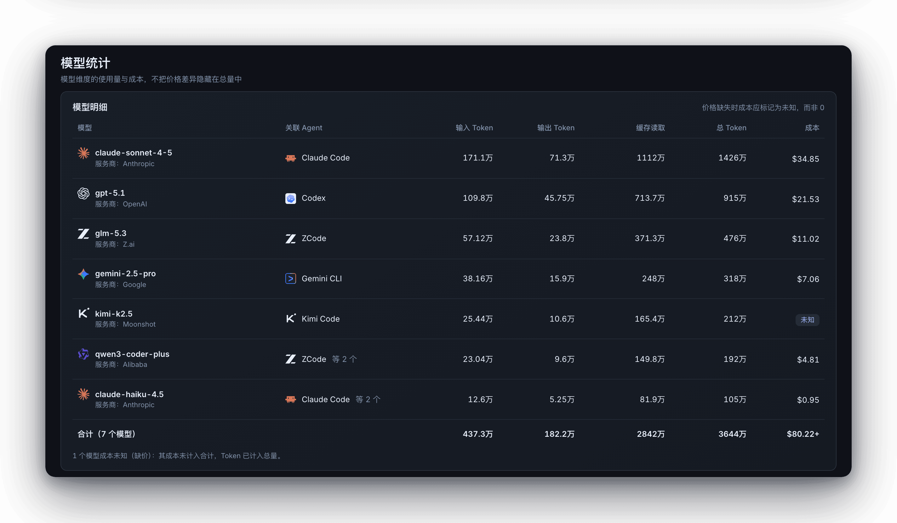
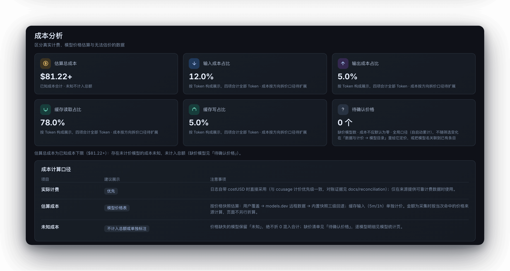
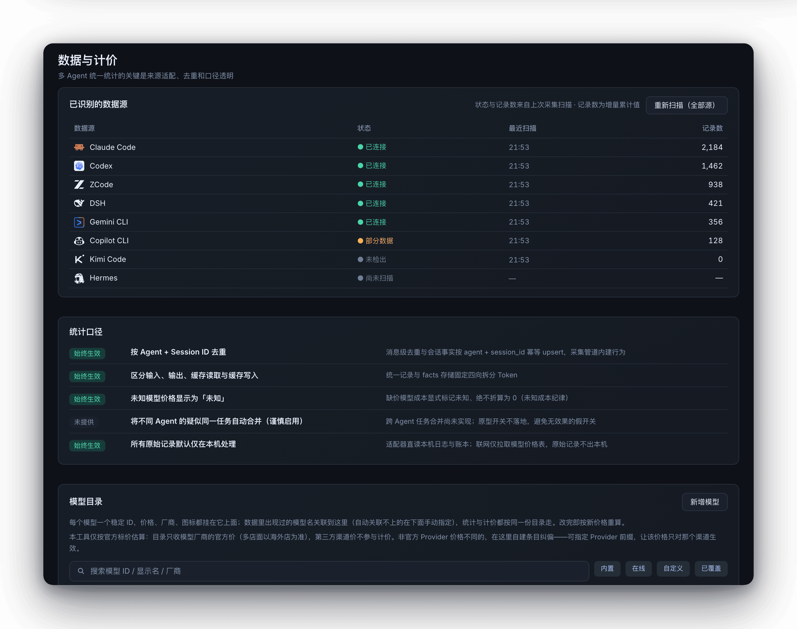
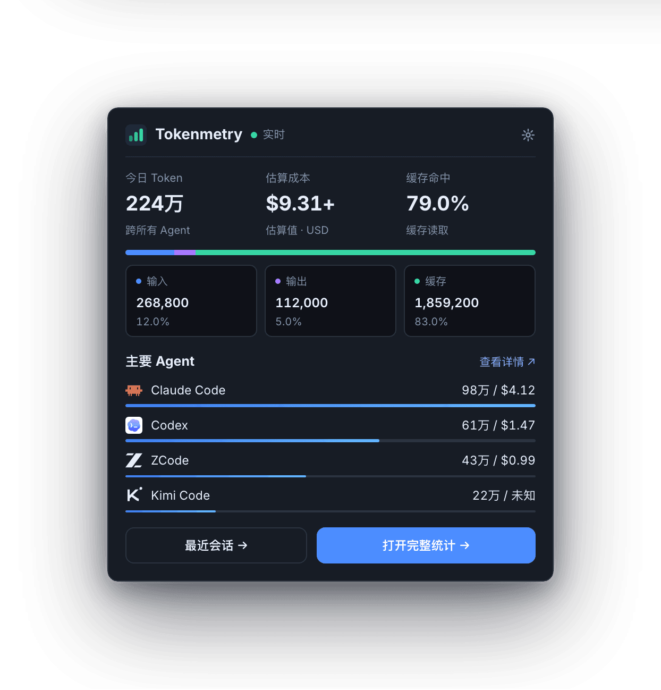

<div align="center">

  

# Tokenmetry

**打开就知道 AI 编程花了多少钱、是否异常、钱花在哪。**

Tokenmetry 是一款 Windows / macOS / Linux 桌面应用：直读你各个 AI 编程 Agent 留在本机的日志——
Claude Code、Codex、ZCode 等 20 个源——增量落进 SQLite，聚成一套替你选好的固定视图。数据不上传，
每个成本数字都能与 ccusage 对账。

[](https://github.com/cholf5/tokenmetry/actions/workflows/ci.yml)
[](https://github.com/cholf5/tokenmetry/releases/latest)

[](https://tokenmetry.app)
[](LICENSE)

[English](README.md) | **简体中文**

</div>

<p align="center">
  <picture>
    <source media="(prefers-color-scheme: dark)" srcset="docs/screenshots/overview-zh-dark.png">
    
  </picture>
</p>

## 为什么做这个

每个 Agent 一套日志：JSONL、会话快照、SQLite……格式不同、位置不同，混用时你根本说不清今天烧了
多少钱。Tokenmetry 把它们全部只读收进来——零配置自动探测，不 spawn 外部进程。

`ccusage` 每次全量重扫日志，冷启动动辄几十秒（[实测分析](docs/chore/why-ccusage-so-slow.md)）。
Tokenmetry 按文件 mtime 与大小记账，变更才重扫，增量落进本地 SQLite——窗口打开，数字就在。

而估算就是估算，没法核对的数字只是猜。所以成本被当作正确性指标来做：逐日、逐模型，与 ccusage CLI
对账（[见下文](#数字可对账)）。缺价模型显示**未知**——绝不折零、不混进合计。

## 界面一览

9 个固定视图：总览、会话明细、Agent 统计、模型统计、项目统计、时间分析、成本分析、数据与计价、
设置。不做插件、不做布局自定义——视图是替你选好的，时间范围与 Agent / 模型 / 项目三维筛选贯穿
所有视图。

<div align="center">
  <table>
    <tr>
      <td></td>
      <td></td>
    </tr>
    <tr>
      <td></td>
      <td></td>
    </tr>
  </table>
</div>

它还常驻托盘——今日 Token、估算成本、缓存命中一眼可见，实时速率跟踪，成本异常以徽章标出：

<p align="center">
  
</p>

## 它做什么

<table>
  <tr><td width="220"><strong>20 个数据源只读直读</strong></td><td>零配置自动探测本地日志与数据库——JSONL/JSON 流式解析，或 SQLite 只读连接；不 spawn 外部进程。</td></tr>
  <tr><td><strong>增量采集</strong></td><td>按文件 mtime/大小记账，变更才重扫；重复运行不产生重复记录，文件删除后记录随之移除。</td></tr>
  <tr><td><strong>成本可审计</strong></td><td>日志自带 costUSD 直接采用；缺价模型显示「未知」，不计入成本合计。</td></tr>
  <tr><td><strong>三级定价回退</strong></td><td>用户覆盖 → models.dev 后台刷新（TTL 24 小时，永不阻塞 UI）→ 随应用内置的价格快照。</td></tr>
  <tr><td><strong>托盘常驻</strong></td><td>弹层即见今日 Token、花费与实时速率；成本异常以徽章标出。</td></tr>
  <tr><td><strong>CSV 导出 + 全局筛选</strong></td><td>时间范围、Agent、模型、项目四维筛选贯穿所有视图。</td></tr>
  <tr><td><strong>明暗双主题，10 种界面语言</strong></td><td>简体/繁体中文、英、日、韩、葡（BR）、俄、西、德、法——运行时即时切换，默认跟随系统。</td></tr>
  <tr><td><strong>诚实的空态</strong></td><td>无数据时显示支持的 Agent 清单与重扫按钮，不甩堆栈。</td></tr>
</table>

## 数据源

全部为只读访问（JSONL/JSON 流式解析，或 SQLite 只读连接），支持环境变量覆盖数据目录：

| Agent | 读取方式 | Agent | 读取方式 |
|---|---|---|---|
| Claude Code | JSONL 直读 | Kimi Code | JSONL 直读 |
| Codex CLI | JSONL 直读 | Amp | 线程 JSON |
| ZCode | SQLite 只读 | Droid (Factory) | 会话快照 JSON |
| DSH | zstd 会话日志 | Hermes | SQLite 只读 |
| GitHub Copilot CLI | events.jsonl + otel | Kilo | SQLite 只读 |
| OpenCode | SQLite 只读 | Codebuff | chat-messages JSON |
| Gemini CLI | JSON / JSONL | pi-agent | 会话目录 |
| Qwen Code | JSONL 直读 | OpenClaw | SQLite + 双格式 |
| Goose | SQLite 只读 | Antigravity | SQLite 多根去重 |
| Grok | updates.jsonl | Cindy | pi 会话目录 |

Cindy 只接 Pi runtime：用它启动的 Claude Code / Codex 会话仍计入各自 Agent；网关回填的 0 成本按
「未知」处理，不折零；同一份会话文件只出一份账，不双算。

## 安装

从 [Releases](https://github.com/cholf5/tokenmetry/releases/latest) 下载。每次打 tag，CI 都会
产出三平台安装包：

| 平台 | 安装包 | 体积（v0.3.2） | 说明 |
|---|---|---|---|
| Windows x64 | `Tokenmetry-0.3.2-win-x64-setup.exe` | 17.3 MB | 推荐——按用户安装，带快捷方式与卸载器；应用内静默升级 |
| Windows x64 | `Tokenmetry-0.3.2-win-x64.zip` | 70.8 MB | 便携版，单 exe |
| macOS Apple Silicon | `Tokenmetry-0.3.2-osx-arm64.zip` | 23.1 MB | `.app`，Native AOT |
| macOS Intel | `Tokenmetry-0.3.2-osx-x64.zip` | 24.6 MB | `.app`，Native AOT |
| Linux x64 | `Tokenmetry-0.3.2-linux-x64.zip` | 66.4 MB | 单文件 |

Windows 安装版的「检查更新」会下载安装包、静默升级并自动重启；便携版与 macOS / Linux 解压覆盖旧
版本即完成更新。

**macOS 首次打开需放行一次**（应用未签名，且 macOS 26 上右键「打开」已经不管用了）：要么在
「系统设置 → 隐私与安全性 → 仍要打开」里放行，要么一行命令省掉全部麻烦：

```bash
xattr -cr /Applications/Tokenmetry.app
```

Windows 会被 SmartScreen 拦一次（→「更多信息」→「仍要运行」）。两者的完整步骤见
[已知限制](docs/release/known-limitations.md)第 9 条。

**从源码运行**——需要 [.NET 10 SDK](https://dotnet.microsoft.com/download/dotnet/10.0)，且本机
用过上表任一 Agent（有本地日志）：

```bash
git clone https://github.com/cholf5/tokenmetry.git
cd tokenmetry
dotnet run --project src/Tokenmetry.App
```

## 数字可对账

自研链路（JSONL / SQLite 直读 → 统一 usage 记录 → 自有定价引擎 → UTC 自然日聚合）与
`npx ccusage@20.0.29` 逐日 × 逐模型对账：

- tokens 五分量精确一致——输入、输出、缓存写入、缓存读取、合计；
- 真实数据实测（本机 Codex：19 个文件 / 2,931 条记录），cost 全期**逐分钱一致**：$101.3856438；
- 对账测试只解析提交进仓库的 golden JSON，离线可重复。口径逐项对齐规则（costUSD 优先、`-fast`
  剥价、消息去重、cumulative 守卫等）见
  [`docs/reconciliation/2026-10-11-reconciliation.md`](docs/reconciliation/2026-10-11-reconciliation.md)。

## 隐私

SQLite 只存**聚合事实与配置**，不存 prompt、代码、会话内容。所有数据留在本机（Windows 为
`%LOCALAPPDATA%\Tokenmetry\`，macOS / Linux 为用户数据目录）。仅有的两个网络触点是 models.dev
价格刷新与应用内更新检查。

## 已知限制

宁可写成文字，也不假装没有（[完整清单](docs/release/known-limitations.md)）：

- 所有包均未签名——Windows 的 SmartScreen 与 macOS 的 Gatekeeper 首次会各拦一次。
- 某源读失败会被静默吞掉：界面仍显示正常，但该源可能少算。这是发版后的第一优先级。
- 改过系统时区（或经历夏令时切换）后，某些日子可能双算。
- 一条坏时间戳能让 Kimi 或 DSH 整源停摆，直到移走坏文件。
- 只有 Windows 安装版能静默升级；便携版与 macOS / Linux 需手动解压覆盖。

## 架构与开发

```
Tokenmetry.Core             模型 · 适配器接口 · 查询/定价/异常检测 · 内置价格快照
        ▲
Tokenmetry.Infrastructure   20 源适配器 · SQLite facts 存储（schema_migrations 顺序迁移）
                            · ModelsDev 定价客户端 · ccusage CLI 对账集成
        ▲
Tokenmetry.App              Avalonia UI（Semi 主题）· 9 视图 · DI · 托盘 · i18n
```

三层严格单向依赖。新增一个数据源 = Core 接口 + Infrastructure 适配器 + DI 注册 + fixture 测试。
面向 AI Agent 的工程约定（架构边界、i18n/设计令牌纪律、命名史陷阱）见 [`AGENTS.md`](AGENTS.md)。

```bash
dotnet build Tokenmetry.sln     # 构建
dotnet test  Tokenmetry.sln     # 全部测试
```

.NET 10 / C# / Avalonia 12；1,600+ 测试（xUnit + FluentAssertions），UI 层跑在 Avalonia Headless
上，无需显示器。改解析、计价或聚合口径之前，先读
[对账文档](docs/reconciliation/2026-10-11-reconciliation.md)——与 ccusage 的逐项对齐表在那里。

## 路线图

| 里程碑 | 内容 | 状态 |
|---|---|---|
| v0.1–v0.2 | 真实数据 Dashboard、Reports、CSV 导出、Settings | ✅ |
| v0.3 | 自主采集引擎（Claude/Codex 直读、facts 存储、定价引擎、对账测试） | ✅ |
| v0.3.5 | 多源覆盖（20 源适配器全部落地） | ✅ |
| v0.4 | UI 原型落地（Semi 主题 + 三栏外壳 + 9 视图 + 图表） | ✅ |
| v0.3.1–v0.3.2 | Windows 安装器 + 应用内静默升级；安装器切 Native AOT | ✅ |
| v0.9 | 发布自动化（tag 触发三平台 CI 打包 + Releases + 应用内更新检查） | ✅ |
| v0.5 | 常驻体验（通知去重、预算阈值、自启、刷新可靠性） | 规划 |
| v1.0 | 稳定发布（Windows 安装器 ✅，macOS 公证 ⬜） | 进行中 |

完整方向见 [`docs/kanban/roadmap.md`](docs/kanban/roadmap.md)，任务卡片看板见
[`docs/kanban/board.md`](docs/kanban/board.md)。

## License

以 **AGPL-3.0-or-later** 发布（全文见 [`LICENSE`](LICENSE)）。你可以自由地使用、学习、修改和再
分发本项目，包括在公司内部日常使用；修改后的版本无论以何种形式提供——分发安装包，还是仅作为
网络服务运行——都必须以相同许可证开放完整源代码。需要在不满足 AGPL 义务的场景下闭源集成，欢迎
通过 GitHub Issues 联系作者单独协商商业授权。

「Tokenmetry」名称与应用图标属于项目品牌标识，不在本许可证授权范围内；再分发衍生版本时请更换
品牌，或明确标注为非官方版本。
