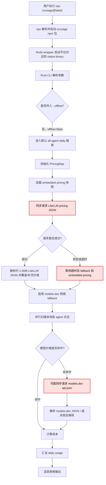
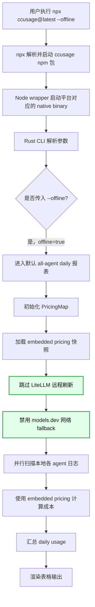
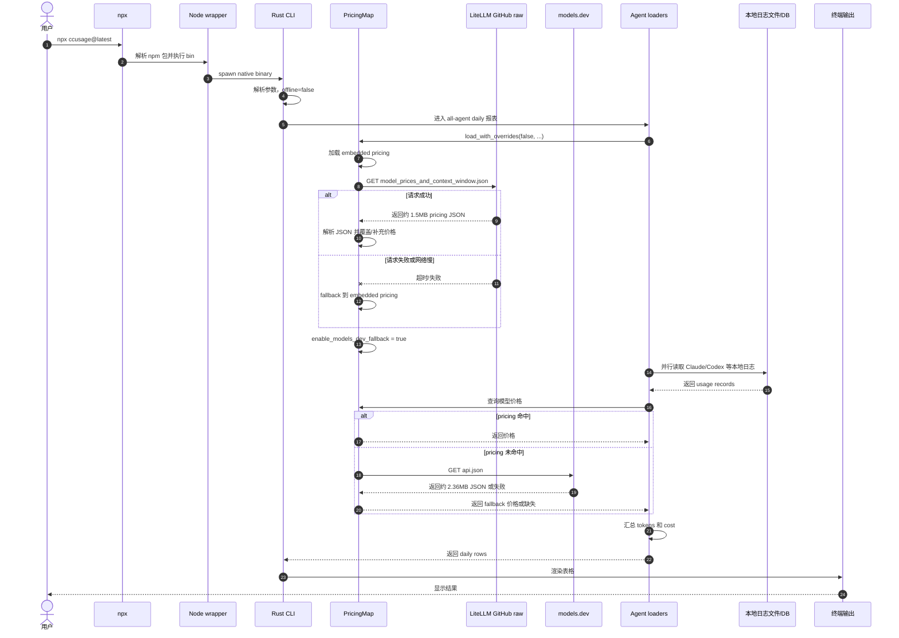
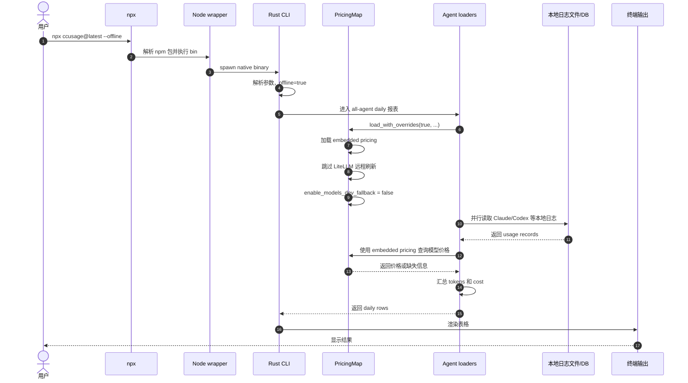

# 调查报告：为什么 `ccusage` 这么慢

## 1. 结论摘要

`ccusage` 变慢的主要原因不是本地 token 日志统计，而是：

> **默认运行时会同步联网刷新模型价格数据，导致命令启动被网络请求阻塞。**

在实际复现中：

```text
npx --yes ccusage@latest --offline  => 4.01s
npx --yes ccusage@latest            => 21.04s
npx --yes ccusage@latest --help     => 2.68s
```

也就是说：

- `npx` 本身有约 **2.7 - 4 秒**启动开销；
- 本地日志统计在 `--offline` 模式下约 **4 秒内完成**；
- 默认模式额外多出的约 **17 秒**主要来自联网刷新价格表 / fallback 价格源。

因此，`ccusage` “几十秒才出结果”的核心原因是：

> **默认非 offline 模式下，每次运行都会同步刷新远程 pricing 数据，而网络请求和大 JSON 解析拖慢了 CLI 输出。**

---

## 2. 复现环境与命令

用户实际使用方式：

```bash
npx ccusage@latest
```

本次调查使用等价命令：

```bash
npx --yes ccusage@latest
npx --yes ccusage@latest --offline
npx --yes ccusage@latest --help
```

环境信息：

```text
node: v25.2.1
npm: 11.6.2
npx: 11.6.2
```

---

## 3. 实测结果

### 3.1 默认运行

```text
npx ccusage@latest default: 21.0351289 s, exit=0
```

### 3.2 offline 运行

```text
npx ccusage@latest --offline: 4.0140862 s, exit=0
```

第二次 offline 运行：

```text
second offline: 3.7859593 s, exit=0
```

### 3.3 help 启动

```text
npx ccusage@latest --help: 2.6770875 s, exit=0
```

### 3.4 价格源网络请求

单独访问远程价格源：

```text
https://raw.githubusercontent.com/BerriAI/litellm/main/model_prices_and_context_window.json
=> 2.3390095 s, bytes=1508118

https://models.dev/api.json
=> 2.3972015 s, bytes=2360227
```

两个远程 JSON 分别约：

- LiteLLM pricing：**1.5MB**
- models.dev API：**2.36MB**

---

## 4. 源码分析

### 4.1 `ccusage` 无参数默认进入 all-agent daily 报表

源码位置：

```text
rust/crates/ccusage/src/main.rs:149
```

无参数时构造 all-agent daily 报表：

```rust
None => {
    let args = AgentCommandArgs {
        shared: cli.shared,
        kind: AgentReportKind::Daily,
        pi_path: None,
        open_claw_path: None,
        codex_speed: cli::CodexSpeed::Auto,
    };
    adapter::all::run(args)
}
```

也就是说：

```bash
ccusage
```

默认不是只统计 Claude Code，而是进入 all-agent daily 汇总路径。

---

### 4.2 all-agent 加载开始时会初始化 pricing

源码位置：

```text
rust/crates/ccusage/src/adapter/all/loader.rs:28
```

相关代码：

```rust
let pricing = PricingMap::load_with_overrides(
    shared.offline,
    crate::log_level() != Some(0),
    shared.pricing_overrides.iter(),
);
```

这一步发生在加载各 agent 数据之前，因此价格表刷新会阻塞整个命令输出。

---

### 4.3 默认 `offline=false`

源码位置：

```text
rust/crates/ccusage-cli/src/types.rs:35
rust/crates/ccusage-cli/src/types.rs:45
```

`SharedArgs` 使用默认 derive：

```rust
#[derive(Clone, Debug, Default)]
pub struct SharedArgs {
    ...
    pub offline: bool,
    pub no_offline: bool,
    ...
}
```

Rust 中 `bool` 默认值是 `false`，因此普通 `ccusage` 默认是：

```text
offline = false
```

---

### 4.4 非 offline 时会刷新 LiteLLM 价格表

源码位置：

```text
rust/crates/ccusage/src/pricing.rs:213
rust/crates/ccusage/src/pricing.rs:218
```

相关代码：

```rust
pub(crate) fn load_with_overrides<'a, I>(offline: bool, log: bool, overrides: I) -> Self
where
    I: IntoIterator<Item = (&'a String, &'a PricingOverride)>,
{
    let mut map = Self::load_embedded();
    if !offline {
        let fetch_result = crate::progress::track_status(
            log && crate::progress::usage_load_output_is_tty(),
            "Refreshing model pricing from LiteLLM...",
            fetch_pricing_json,
        );
        ...
    }
    ...
}
```

这说明：

```bash
ccusage
```

会联网刷新价格表；

```bash
ccusage --offline
```

不会联网刷新价格表。

---

### 4.5 LiteLLM URL 与超时设置

源码位置：

```text
rust/crates/ccusage/src/pricing.rs:18
rust/crates/ccusage/src/pricing.rs:21
rust/crates/ccusage/src/pricing.rs:1227
```

URL：

```rust
const LITELLM_PRICING_URL: &str =
    "https://raw.githubusercontent.com/BerriAI/litellm/main/model_prices_and_context_window.json";
```

超时：

```rust
const PRICING_FETCH_TIMEOUT_SECONDS: u64 = 10;
```

请求代码：

```rust
let agent = ureq::Agent::config_builder()
    .timeout_global(Some(Duration::from_secs(PRICING_FETCH_TIMEOUT_SECONDS)))
    .build()
    .new_agent();
```

因此，如果 GitHub raw 访问慢、代理不稳定、DNS 慢、网络被阻断，每次运行都可能卡到 10 秒级。

---

### 4.6 非 offline 还会启用 models.dev fallback

源码位置：

```text
rust/crates/ccusage/src/pricing.rs:242
rust/crates/ccusage/src/pricing.rs:372
rust/crates/ccusage/src/pricing.rs:1172
```

非 offline 时：

```rust
map.enable_models_dev_fallback = !offline;
```

价格查找 miss 时：

```rust
self.enable_models_dev_fallback
    .then(|| {
        models_dev_pricing()
            .and_then(|pricing| pricing.find_entry_or_alias(resolved_alias))
    })
```

models.dev URL：

```text
https://models.dev/api.json
```

源码位置：

```text
rust/crates/ccusage/src/pricing.rs:20
```

这意味着默认模式下除了 LiteLLM 价格刷新，还可能触发 models.dev 网络 fallback。

---

## 5. 执行流程图对比

下面用 Mermaid 对比默认模式和 `--offline` 模式的关键差异：默认模式会在统计前同步联网刷新 pricing；`--offline` 模式则直接使用内置价格快照，跳过远程请求。

### 5.1 不使用 `--offline`：默认联网刷新 pricing



关键慢点：

- `LiteLLM pricing JSON` 每次默认运行都会同步请求；
- 请求失败或网络慢时，可能卡到 10 秒级超时；
- 非 offline 还会启用 `models.dev` 网络 fallback，模型价格 miss 时可能继续触发远程请求；
- 所有这些都发生在用户看到最终报表之前。

### 5.2 使用 `--offline`：跳过远程 pricing 请求



关键收益：

- 不请求 GitHub raw 上的 LiteLLM pricing JSON；
- 不启用 models.dev 网络 fallback；
- 成本计算使用发布包内置的 pricing snapshot；
- 命令耗时主要剩下 `npx` 启动开销和本地日志扫描。

### 5.3 不使用 `--offline`：调用时序



这个时序图里，用户等待时间会被两类远程调用拉长：启动阶段的 LiteLLM pricing refresh，以及价格 miss 时的 models.dev fallback。

### 5.4 使用 `--offline`：调用时序



这个时序图里，远程 pricing 请求被完全跳过，主路径只剩 `npx` 启动、native binary 执行、本地日志读取和汇总输出。

---

## 6. 慢在哪里？

可以粗略拆分为：

| 阶段 | 耗时 |
|---|---:|
| `npx` 启动、解析包、运行 native binary | 约 2.7 - 4s |
| 本地日志扫描、统计、输出 | 包含在 offline 的 4s 内 |
| 默认模式额外价格刷新 / fallback | 约 17s |
| 默认总耗时 | 约 21s |

所以性能瓶颈排序：

1. **远程 pricing refresh / fallback：最大瓶颈**
2. `npx` 启动开销：次要瓶颈
3. 本地日志统计：不是主要瓶颈

---

## 7. 为什么以前快，现在慢？

可能有几个叠加因素：

### 6.1 LiteLLM 模型价格表越来越大

当前 LiteLLM pricing JSON 约 1.5MB，并且会随着模型数量增加而继续变大。

每次运行都下载并解析完整 JSON，会越来越慢。

### 6.2 models.dev fallback 也越来越大

当前 `models.dev/api.json` 约 2.36MB。

如果某些模型价格在 LiteLLM 表中 miss，就可能触发额外 fallback。

### 6.3 网络环境波动

GitHub raw 在不同地区、不同代理环境下延迟差异很大。

如果网络访问 GitHub raw 慢，`ccusage` 默认运行就会直接变慢。

### 6.4 `npx ccusage@latest` 每次都有启动成本

`npx` 会解析包、处理缓存、启动 Node 包装器，再运行 native binary。
这部分不是主因，但会贡献几秒固定成本。

---

## 8. 立即可用的解决方案

### 8.1 日常使用加 `--offline`

推荐：

```bash
npx --yes ccusage@latest --offline
```

或者：

```bash
npx ccusage@latest --offline
```

这能绕过远程价格刷新，实测从约 21 秒降到约 4 秒。

---

### 8.2 全局安装，减少 npx 开销

如果经常使用，建议：

```bash
npm i -g ccusage@latest
```

之后运行：

```bash
ccusage --offline
```

这样可以同时避免：

1. `npx` 的包解析/启动开销；
2. 默认联网刷新 pricing 的开销。

理论上会比：

```bash
npx ccusage@latest --offline
```

更快。

---

### 8.3 配置默认 offline

可以在 ccusage 配置中设置：

```json
{
  "$schema": "https://ccusage.com/config-schema.json",
  "defaults": {
    "offline": true
  }
}
```

这样日常运行可以直接：

```bash
ccusage
```

而不必每次写：

```bash
ccusage --offline
```

需要注意：如果继续用 `npx ccusage@latest`，仍然会有 npx 自身开销。

---

## 9. `--offline` 会不会导致价格不准？

不会完全没有价格。

源码中已经有 embedded pricing：

```text
rust/crates/ccusage/src/pricing.rs:201
```

它会加载构建期内置价格表：

```rust
pub(crate) fn load_embedded() -> Self {
    let mut map = Self::default();
    ...
    map.load_json_with_overrides(BUILD_TIME_PRICING_JSON, &fast_multiplier_overrides);
    map.put_builtin_pricing(&fast_multiplier_overrides);
    ...
    map
}
```

也就是说，`--offline` 使用的是发布包构建时内置的价格快照。

影响是：

- 优点：快、稳定、不依赖网络；
- 缺点：可能不是最新价格表；
- 对日常统计来说通常足够；
- 如果非常在意最新模型价格，可以偶尔不加 `--offline` 跑一次。

---

## 10. 给上游的建议

这个问题适合给上游提 issue 或 PR。

### 10.1 Issue 标题建议

```text
Default ccusage run is slow because it synchronously refreshes remote pricing data every time
```

### 10.2 Issue 关键证据

```text
npx --yes ccusage@latest --offline  => 4.01s
npx --yes ccusage@latest            => 21.04s
```

### 10.3 建议优化方向

建议上游考虑：

1. 默认使用 embedded pricing；
2. 远程 pricing 做本地缓存；
3. 缓存设置 TTL，例如 24 小时；
4. 提供显式刷新参数，例如：

   ```bash
   ccusage --refresh-pricing
   ```

5. 或将现在的联网行为改为显式：

   ```bash
   ccusage --no-offline
   ```

6. models.dev fallback 也应该缓存/限频；
7. 普通统计命令不应被远程网络请求阻塞；
8. 如果远程刷新失败，应快速 fallback 到 embedded pricing，而不是明显拖慢主路径。

---

## 11. 最终结论

`ccusage` 变慢的根因是：

> **默认运行不是纯本地统计，而是每次同步联网刷新模型价格数据。**

实测：

```text
默认运行：21.04s
offline：4.01s
```

因此：

```bash
npx ccusage@latest
```

慢，主要慢在：

```text
LiteLLM pricing refresh + models.dev fallback + 网络/解析开销
```

不是主要慢在：

```text
本地 token 日志扫描
```

当前最实用的解决方案是：

```bash
npx ccusage@latest --offline
```

更推荐长期方案：

```bash
npm i -g ccusage@latest
ccusage --offline
```

如果配置默认 offline，则可以恢复接近以前“秒出”的体验。
